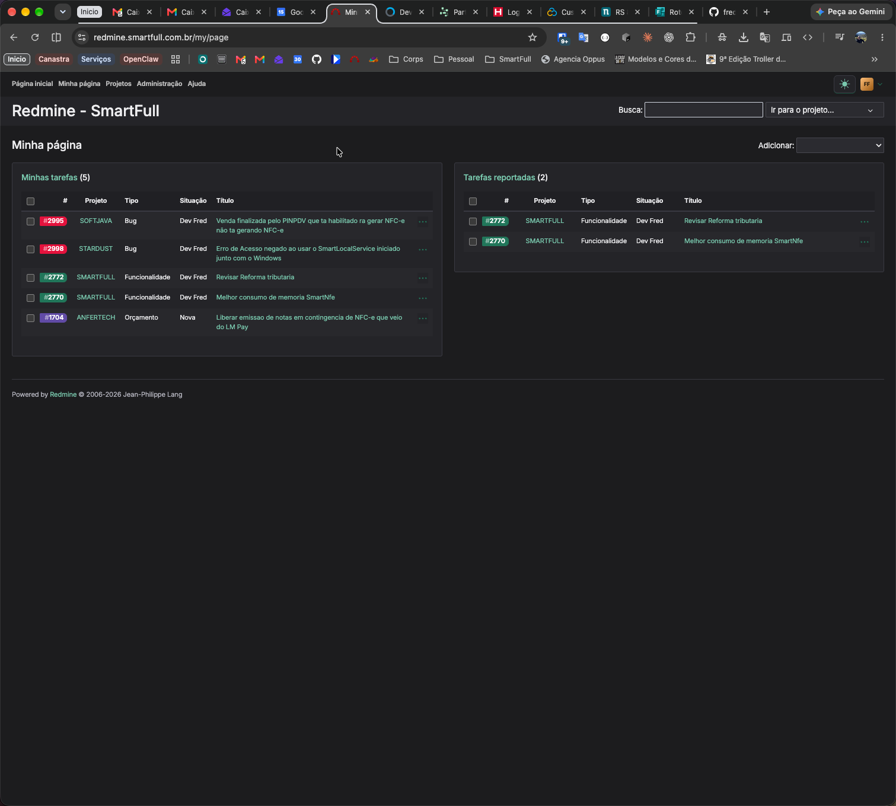
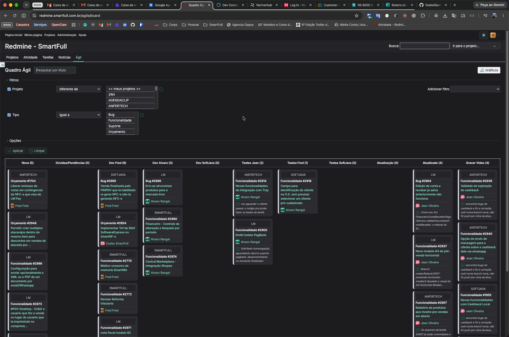

# SmartFull Redmine Theme

Tema para Redmine com paleta grafite e verde suave, modos claro e escuro e ajustes de compatibilidade visual com Redmine 7. Derivado do **WS Opale**, que por sua vez deriva do **Opale** e do **PurpleMine2**.



## Recursos

- Alternância claro/escuro com botão visível junto ao usuário; preferência salva no navegador.
- Aparência automática conforme a preferência do sistema quando não há escolha manual.
- Cabeçalho grafite e links verdes, com contraste adaptado a cada modo.
- Textos, tabelas e cartões de projetos e de Minha página adaptados ao tema.
- Quadro RedmineUP Agile com fundo e cartões integrados à paleta, preservando os indicadores de prioridade.
- Seletor de projetos e menu do usuário com fundos opacos e contraste adequado.
- CSS e JavaScript versionados por data e hash do conteúdo.
- Integração opcional para invalidar o HTML de Atividade quando a versão do tema muda.

## Compatibilidade

A versão SmartFull foi ajustada e conferida em uma instalação de **Redmine 7.0.1**, com **RedmineUP Agile Light 1.7.0**. O WS Opale original declara suporte a Redmine 6.x; outras versões não foram homologadas nesta adaptação.

### Quadro Ágil no modo escuro

**Compatível visualmente com o plugin RedmineUP Agile**, responsável pelo quadro Ágil (Kanban). A adaptação inclui estilos específicos para que o quadro acompanhe os modos claro e escuro do tema, com fundo, cartões, cabeçalhos, títulos e comentários legíveis, preservando os indicadores de prioridade.

Essa integração evita que os cartões mantenham fundos claros ou textos com pouco contraste quando o modo escuro está ativo. O resultado abaixo foi validado na instalação SmartFull com **RedmineUP Agile Light 1.7.0**; outras versões e a edição PRO ainda não foram homologadas.



## Instalação

1. Baixe este repositório e copie o conteúdo para `themes/smartfull` dentro da instalação do Redmine. Não copie `node_modules` nem `.git`.
2. Na administração do Redmine, selecione o tema **Smartfull** em **Configurações → Exibição** e salve.
3. Compile os assets do Redmine e reinicie o serviço:

   ```sh
   bundle exec rake assets:precompile RAILS_ENV=production
   ```

Em Docker, a pasta do tema precisa estar montada em `/usr/src/redmine/themes/smartfull`. Também é possível preservar o nome de instalação `ws_opale`.

### Cache e arquivos versionados

Para ativar os nomes com data e a correção de cache de Atividade, copie `src/integration/redmine_smartfull_theme_cache` para `plugins/redmine_smartfull_theme_cache` na instalação do Redmine, compile os assets e reinicie o serviço. O plugin não possui migrations e não modifica os arquivos originais do Redmine.

O plugin usa `theme-release.json` para selecionar os arquivos CSS/JS versionados e incluir a versão do tema no validador do HTML de Atividade. Sem essa integração, os arquivos convencionais `application.css` e `theme.js` continuam disponíveis.

Veja o [guia da integração](src/integration/README.md).

## Desenvolvimento

Requer Node.js e npm compatíveis com as dependências do projeto.

```sh
npm ci --ignore-scripts
npm run build
```

O build compila o SCSS, processa o CSS e gera `theme-release.json` e arquivos `application-AAAAMMDD-HASH.css` e `theme-AAAAMMDD-HASH.js`. A data usa o fuso `America/Sao_Paulo` e o hash considera o conteúdo de ambos os arquivos.

A paleta e os ajustes SmartFull ficam em [`src/sass/_smartfull.scss`](src/sass/_smartfull.scss). As regras herdadas de modo escuro do WS Opale ficam em [`src/sass/_ws-opale-dark.scss`](src/sass/_ws-opale-dark.scss).

Após publicar uma nova versão, execute a compilação de assets e reinicie o Redmine. Preserve os assets versionados anteriores durante a atualização para atender páginas que ainda os referenciem.

## Créditos

Este projeto é uma adaptação de trabalhos anteriores, não uma criação integral da SmartFull:

- **WS Opale:** [wsagency/ws-redmine-opale-theme](https://github.com/wsagency/ws-redmine-opale-theme), por **Kristijan Lukacin / Web Solutions Ltd**. Base desta adaptação: commit `6b9cd4bfc2cb33dd0d16df52ba012e3b137981bd`.
- **Opale:** [gagnieray/opale](https://github.com/gagnieray/opale), por **Guillaume AGNIERAY**.
- **PurpleMine2:** [mrliptontea/PurpleMine2](https://github.com/mrliptontea/PurpleMine2), por **Grzegorz Rajchman** e demais colaboradores listados em [`AUTHORS.md`](AUTHORS.md).
- **Adaptação SmartFull:** paleta grafite/verde, ajustes de contraste e layout para Redmine 7, integração visual com Agile e versionamento/cache.

Componentes de terceiros preservam seus créditos e licenças: **Normalize.css**, **Bootstrap Mixins** e **Tabler Icons** (MIT); **Inter** mantém sua licença própria.

O [README original do WS Opale](docs/README-WS-Opale.md) foi preservado para registrar a origem.

## Licenças

O código herdado do Opale inclui partes sob **AGPL-3.0** e partes anteriores sob **MIT**, conforme [`AUTHORS.md`](AUTHORS.md). As adaptações SmartFull são distribuídas sob **AGPL-3.0**, preservando os direitos e avisos das partes herdadas.

O upstream WS Opale declara AGPL-3.0 no README, mas fornece um arquivo `LICENSE` MIT. Ambos os registros são preservados: [`LICENSE`](LICENSE) contém o aviso MIT recebido da Web Solutions Ltd; [`LICENSE-AGPL-3.0.txt`](LICENSE-AGPL-3.0.txt) contém a licença AGPL-3.0 aplicável às partes correspondentes. Não se deve interpretar o arquivo MIT isoladamente como relicenciamento de todo o código herdado.
